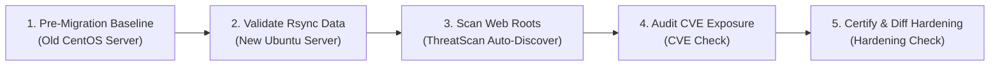

<div align="center">
  

  # 🛡️ Guardrail

  **Server Migration, Security Hardening, CVE Assessment & Web Threat Detection Suite**  
  *Operational security and validation toolkit for Linux server migrations (CentOS → Ubuntu LTS)*

  
  
  -Console%20%7C%20HTML%20%7C%20JSON%20%7C%20SARIF%20%7C%20JUnit-6366F1?style=flat-square)
  
</div>

---

## 📦 Toolkit Overview

| Tool | Category | Key Capabilities |
| :--- | :--- | :--- |
| 🛡️ **[`guardrail.sh`](guardrail.sh)** | **Unified Orchestrator** | Master CLI orchestrator with an interactive launcher, unified dependency checks, and automated cross-suite verification. |
| 🔄 **[`migration-validate/`](migration-validate/README.md)** | **Data Integrity** | Validate `rsync` migration accuracy per folder using multi-server profiles, file/symlink/byte counters, deep SHA checksums, and TUI progress bars. |
| 🔒 **[`hardening-check/`](hardening-check/README.md)** | **System Hardening** | Cross-distro security audit & scoring across SSH, Firewall, Web Server, TLS/SSL, PHP, Database, Password Policy, and Kernel parameters with baseline diffing. |
| 🔍 **[`cve-check/`](cve-check/README.md)** | **Vulnerability Audit** | Offline-first CVE exposure assessment via curated advisory rules, native distro security feeds (`apt`/`dnf`/`yum`), and optional OSV API lookups. |
| 🦠 **[`threatscan/`](threatscan/README.md)** | **Web Malware Scanner** | Enterprise PHP/Web root scanner with **Auto-Discovery**, interactive multi-project selection, YARA rules, Shannon entropy, heuristic scoring, Git-aware scanning, and quarantine. |

---

## ✨ What's New in ThreatScan v2.0

- 🧭 **Automatic Web Root Discovery** — Automatically locates web roots from active **Nginx** (`root`) and **Apache/HTTPD** (`DocumentRoot`) virtual host configs as well as standard paths (`/var/www/html`, `/var/www`, `/srv/www`, `/home/*/public_html`).
- 🗂️ **Smart Sub-Project Detection & Interactive Menu** — Detects multi-tenant subdirectories (e.g., `/var/www/html/web-a`, `/var/www/html/web-b`), identifies the framework (`Laravel`, `WordPress`, `CodeIgniter`, `Symfony`, `Drupal`, `Joomla`, `Native PHP`), and prompts you to scan a single project, multiple projects (`1,2`), all projects (`A`), or the parent root (`R`).
- 📊 **Multi-Format Reporting** — Generates interactive **HTML Dashboards**, **SARIF 2.1.0** (GitHub Code Scanning), **JSON**, **JUnit XML**, and rich **Console** tables.

---

## ⚙️ System Requirements

| Requirement | Scope | Notes |
| :--- | :--- | :--- |
| 🔧 `bash`, `find`, `grep`, `sed`, `awk` | **All Tools** | Standard POSIX utilities available out of the box. |
| 📋 `jq` | **`threatscan`** | Required by `threatscan` for structured result aggregation and reporting. |
| 🚀 `yara`, `php-cli`, `parallel`, `git`, `clamscan`, `curl` | **Optional (`threatscan`)** | Enables YARA engine, PHP AST checks, multi-core parallelism, Git diff scanning, and Threat Intel. |

### ✅ Verify Host Readiness

Run the built-in self-tests before starting a maintenance window (safe, read-only, touches no production files):

```bash
# Verify entire suite with one command
./guardrail.sh self-test
./guardrail.sh --check-deps

# Or verify individually:
bash threatscan/threatscan.sh --self-test
bash cve-check/cve-check.sh --self-test
bash hardening-check/hardening-check.sh --self-test
bash migration-validate/migration-validate.sh --self-test
```

---

## 🧭 Interactive Web Root Discovery (`threatscan`)

When `/var/www/html` hosts multiple applications (such as `web-a` and `web-b`), `threatscan` automatically detects each project and presents an interactive selector:

```bash
# Auto-discover web folders across the system and choose interactively
sudo bash threatscan/threatscan.sh

# Scan /var/www/html (automatically prompts if sub-projects like web-a & web-b exist)
sudo bash threatscan/threatscan.sh /var/www/html --output console,html,json

# List all discovered web projects without scanning
sudo bash threatscan/threatscan.sh --list-targets
sudo bash threatscan/threatscan.sh /var/www/html --list-targets

# Non-interactive: scan all discovered web projects sequentially
sudo bash threatscan/threatscan.sh /var/www/html --all-targets --output console,html,json
```

**Interactive CLI Preview:**

```text
[*] Found 2 web project(s) under /var/www/html:

  [1] /var/www/html/web-a          (Laravel      • ~1,420 files • subfolder (/var/www/html))
  [2] /var/www/html/web-b          (WordPress    • ~3,810 files • subfolder (/var/www/html))
  ──────────────────────────────────────────────────────────────────────────────
  [A] Scan ALL projects sequentially (1-2)
  [R] Scan parent root directly as a single scan (/var/www/html)
  [Q] Quit

Select target to scan (e.g. 1, 1,2, 1-2, A, R, Q):
```

---

## 🛠️ Standard Server Migration Workflow



```bash
# 1️⃣ On the source CentOS server — capture a pre-migration hardening baseline
sudo bash hardening-check/hardening-check.sh --benchmark --json > baseline-centos.json

# 2️⃣ On the destination Ubuntu server — validate migrated folders against source
sudo bash migration-validate/migration-validate.sh --server srv1

# 3️⃣ Discover and scan migrated web applications for webshells & backdoors
sudo bash threatscan/threatscan.sh /var/www/html --output console,html,json

# 4️⃣ Assess open CVEs and pending security updates
sudo bash cve-check/cve-check.sh --benchmark --json > cve-ubuntu.json

# 5️⃣ Capture post-migration hardening baseline on Ubuntu
sudo bash hardening-check/hardening-check.sh --benchmark --json > baseline-ubuntu.json

# 6️⃣ Compare before vs. after hardening posture and catch regressions
sudo bash hardening-check/hardening-check.sh --benchmark --diff baseline-centos.json

# 7️⃣ Quick verification after remediation (Exit 0 = no CRITICAL/HIGH issues)
sudo bash hardening-check/hardening-check.sh --quick
sudo bash cve-check/cve-check.sh --severity HIGH
```

> [!NOTE]
> `cve-check`, `hardening-check`, and `migration-validate` are strictly **read-only**. `threatscan` is read-only by default and only isolates files when `--quarantine` is explicitly passed. Running with `sudo` is recommended for complete configuration coverage.

---

## 📂 Output & Reports

All generated reports and logs are automatically ignored by Git.

| Tool | Default Output Location | Exit Code Behavior |
| :--- | :--- | :--- |
| 🔄 `migration-validate` | `result/` in repository root | `0` all folders match, non-zero on mismatch/error |
| 🔒 `hardening-check` | `result/` in repository root | `0` no CRITICAL/HIGH findings |
| 🔍 `cve-check` | `result/` in repository root | `0` no vulnerabilities at or above threshold |
| 🦠 `threatscan` | `threatscan/reports/` & `threatscan/logs/` | Follows `--fail-on` (default `HIGH`): `0` Clean, `1` LOW/MED, `2` HIGH, `3` CRITICAL |

---

## 🤝 Contributing

Commit messages follow [Conventional Commits](https://www.conventionalcommits.org/). Allowed types, scopes, and formatting rules are documented in [`CONTRIBUTING.md`](CONTRIBUTING.md).
